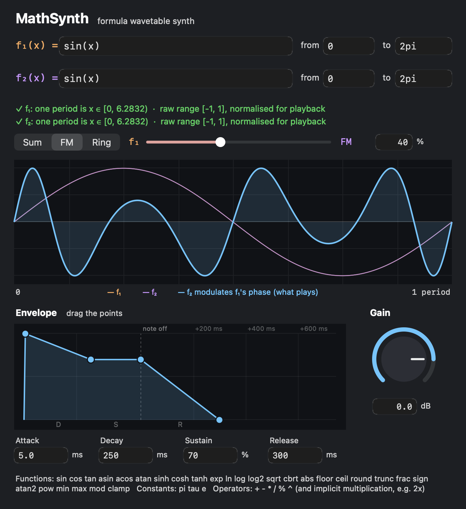

# math-synth

An instrument plugin written in Zig that turns a math formula into a waveform.
It builds as both a VST3 and an Audio Unit, so it works in GarageBand and Logic
as well as VST3 hosts.



There are two waves, f₁ and f₂. For each, type a formula in `x` and choose
the `x` range that makes up one period; the synth turns it into a
single-cycle wavetable. The **Sum / FM / Ring** switch picks how the two are
combined, and the slider next to it sets how much:

| Mode | 0 % | 100 % |
|---|---|---|
| Sum | only f₁ | only f₂ (crossfade in between) |
| FM | only f₁ | f₂ pushes f₁'s phase by up to 2 cycles (phase modulation, 1:1) |
| Ring | only f₁ | f₁ × f₂ |

The plot shows both waves as thin lines and the result, which is what you
hear, in bold. It uses the same calculation as the synth.

Both waves play at the note's pitch, so FM and ring modulation are 1:1 and
always harmonic. FM works best with a smooth modulator such as `sin(x)`: a
square (`sign(sin(x))`) is only ever ±1, so it shifts f₁'s phase in jumps,
and at 50 % and 100 % those jumps are whole cycles that leave f₁ unchanged.

The editor checks the input on every keystroke: valid input updates the
preview and the sound right away. Invalid input shows the error and points at
it, and that wave keeps playing its last valid shape.

Below the plot are an ADSR envelope and an output gain knob.

## Envelope and gain

- **Envelope graph:** drag the points to shape the envelope. The peak sets
  attack, the next point sets decay and sustain, the end of the sustain hold
  sets sustain, and the last point sets release. Double-click a point to reset
  it. Time runs left to right and the view zooms to fit the envelope after
  each drag. The dashed line marks note-off; release times are measured from
  there.
- **Attack, Decay, Sustain, Release fields:** type a value and press Return.
  Times accept `ms` or `s` (`250`, `250 ms`, `1.5 s`), and sustain is a
  percentage.
- **Gain knob:** drag up or down (hold Shift for fine steps), scroll, or
  double-click to reset to 0 dB. You can also type a value in the field
  below it.

| Parameter | Range | Default |
|---|---|---|
| Gain | -60 dB (silent) to +12 dB | 0 dB |
| Attack | 0 to 10 000 ms | 5 ms |
| Decay | 0 to 10 000 ms | 250 ms |
| Sustain | 0 to 100 % | 70 % |
| Release | 0 to 10 000 ms | 300 ms |
| Mix | 0 to 100 % (amount for the mode) | 0 % |
| Mode | Sum, FM, Ring | Sum |

The mix slider works like the knob: click or drag along it, scroll, or
double-click to reset, and the field next to it accepts typed values.

All seven are automatable parameters in both formats, so hosts can record and
automate them. In GarageBand they appear as Smart Controls knobs. The envelope
is linear, and every segment is at least 1 ms long so even 0 ms settings don't
click.

## Formula language

| | |
|---|---|
| Variable | `x` |
| Constants | `pi`, `tau`, `e` |
| Operators | `+ - * / % ^`. `^` is right associative and binds tighter than unary minus, so `-x^2 = -(x^2)`. `%` is floored modulo. |
| Implicit multiplication | `2x`, `3sin(x)`, `(x+1)(x-1)`, `2pi` |
| Functions (1 arg) | `sin cos tan asin acos atan sinh cosh tanh exp ln log log2 sqrt cbrt abs floor ceil round trunc frac sign` |
| Functions (2 args) | `atan2 pow min max mod` |
| Functions (3 args) | `clamp(v, lo, hi)` |

`log` is base 10 and `ln` is natural. The **from** and **to** fields take
constant expressions such as `-pi` or `4*pi`.

Some examples to try:

| Formula | from | to |
|---|---|---|
| `sin(x)` | `0` | `2pi` |
| `x` (saw) | `0` | `1` |
| `sign(sin(x))` (square) | `0` | `2pi` |
| `abs(frac(x) - 0.5)` (triangle) | `0` | `1` |
| `sin(x) + 0.5sin(2x) + 0.25sin(3x)` | `0` | `2pi` |
| `tanh(4sin(x))` | `0` | `2pi` |
| `sin(x)exp(-x/4) + 0.3sign(sin(3x))` | `0` | `4pi` |

Each formula is sampled into a 2048-point table across `[from, to)`. The table
is then centred (DC removed) and peak-normalised, so any formula plays at a
reasonable level. In Sum mode the result is a plain crossfade of the two
tables, so opposite waves (`sin(x)` and `-sin(x)`) cancel out at 50 %. A formula that isn't finite anywhere in the range (for
example `1/x` across 0) is rejected.

## Building

You need Zig 0.16 and macOS. The editor uses Cocoa.

```bash
zig build -Doptimize=ReleaseFast
```

This produces `zig-out/MathSynth.vst3` and `zig-out/MathSynth.component` (and
the same for every other plugin in the repository). To sign them ad hoc and
copy them into `~/Library/Audio/Plug-Ins`:

```bash
zig build install-plugin -Doptimize=ReleaseFast
```

Use `install-vst3` or `install-au` for one format, or `install-mathsynth` for
just this plugin.

To run the unit tests:

```bash
zig build test
```

## Using it in GarageBand or Logic

1. Run `zig build install-au -Doptimize=ReleaseFast`. This also restarts the
   macOS Audio Unit registrar so the new build is picked up.
2. Optionally, check it with Apple's validator, which GarageBand also relies on:
   ```bash
   auval -v aumu MSyn Mthx
   ```
3. In GarageBand, make sure **Settings → Audio/MIDI → Enable Audio Units** is
   checked. It's off by default.
4. Quit and reopen GarageBand. Create a **Software Instrument** track, open the
   track's **Smart Controls** (press B), and under **Plug-ins** click the
   instrument slot. Choose **Audio Units → MathSynth → MathSynth**.
5. Click the plugin slot again to open the editor.

If it isn't listed, run `killall -9 AudioComponentRegistrar` and restart the
app. In Logic you can also rescan it from **Logic Pro → Settings → Plug-in
Manager**.

## VST3 hosts

`zig build install-vst3 -Doptimize=ReleaseFast`, then rescan plugins in your
DAW (REAPER, Bitwig, Ableton Live, Cubase and so on).

## Test hosts

Two minimal hosts check the built bundles without a DAW.

```bash
zig build host -- info
zig build host -- render out.wav "sin(x) + 0.3sin(5x)" 0 2pi
zig build host -- snapshot editor.png "tanh(4sin(x))" 0 2pi "x" 0 1
zig build host -- snapshot fm.png --set mode=FM --set mix=40 "sin(x)" 0 2pi "sin(x)" 0 2pi
zig build host -- interact editor.png
zig build host -- gui
```

`host` drives the VST3. `render` loads the formula through the plugin state
and plays an arpeggio into a WAV file. `snapshot` opens the editor off-screen,
types the given formula/from/to values (f₁'s, then f₂'s) into its fields and
saves a PNG. `--set name=value` (for `snapshot` and `render`) sets a
parameter by name first, the way a host's generic controls would. `interact`
sends mouse events to the envelope graph, the gain knob and the mix slider,
switches the mode to FM, commits a typed attack time, and prints the resulting parameters and the edit gestures reported
to the host. `gui` opens the editor in a window. It has no audio output.

```bash
zig build au-host -- info
zig build au-host -- render out.wav x 0 1
zig build au-host -- snapshot editor.png "sin(x"
zig build au-host -- interact
```

`au-host` does the same for the Audio Unit without installing it. It
registers the component in-process, then only uses the public Audio Unit API:
state goes through `ClassInfo`, notes through `MusicDeviceMIDIEvent`, and the
editor is created through the `CocoaUI` view factory, the way Logic and
GarageBand do it. `interact` drags the gain knob in that editor and checks
that a host-style parameter listener receives the value changes and gestures.

GarageBand and Logic run third-party Audio Units in a separate helper process
(`AUHostingService`) and show the editor remotely. To check that path against
the installed plugin:

```bash
zig build install-au && zig build au-oop
```

`zig build au-oop -- render 48000` also plays A4 through the out-of-process
unit with AVAudioEngine and reports its level and measured pitch.

## Layout

The repository holds plugins that share one set of building blocks:
`src/common` has everything reusable, and each plugin has its own folder.
MathSynth is the first.

| Path | Contents |
|---|---|
| `src/common/plugin.zig` | The contract a plugin implements, and the editor host API |
| `src/common/vst3.zig` | `Wrapper(P)`: any plugin as a VST3 (factory, component/processor/controller, plug view) |
| `src/common/au.zig` | `Wrapper(P)`: any plugin as an Audio Unit v2 (properties, MIDI queue, render, view glue) |
| `src/common/au_view.m` | The AU view factory class, compiled per plugin with its class names |
| `src/common/meta.zig` | Plugin identity (names, IDs, versions) and Info.plist generation |
| `src/common/param.zig` | Parameter descriptions, normalized mapping, formatting/parsing, lock-free value store |
| `src/common/adsr.zig` | Linear ADSR envelope |
| `src/common/triple_buffer.zig` | Lock-free handoff of large values from the UI to the audio thread |
| `src/common/expr.zig` | The formula language: tokenizer, parser, stack-machine evaluator |
| `src/common/gui/objc.zig` | Objective-C runtime and CoreGraphics bindings |
| `src/common/gui/widgets.zig` | Knob and slider drawing |
| `src/common/gui/envelope_graph.zig` | Geometry of an interactive ADSR graph |
| `src/mathsynth/meta.zig` | MathSynth's names and IDs |
| `src/mathsynth/plugin.zig` | MathSynth described for the wrappers |
| `src/mathsynth/vst3.zig`, `au.zig` | Entry points: one line each, exporting the wrappers |
| `src/mathsynth/engine.zig` | The plugin instance: synth, table handoff, parameters, gain, saved state |
| `src/mathsynth/params.zig` | Its parameters (gain, ADSR, mix, mode) |
| `src/mathsynth/synth.zig` | 16-voice wavetable oscillator |
| `src/mathsynth/wavetable.zig` | Formula validation and table building |
| `src/mathsynth/blend.zig` | How the two waves combine (sum, FM, ring), shared by the synth and the plot |
| `src/mathsynth/editor.zig` | The Cocoa editor |
| `tools/` | Test hosts (`host.zig`, `au_host.zig`, `au_oop.m`) |
| `vendor/vst3_c_api` | Steinberg's VST3 C API header (BSD-3 licence), translated with `translate-c` at build time |

The VST3 wrapper makes a single component: one object implements
`IComponent`, `IAudioProcessor` and `IEditController`, so the editor and the
audio engine share state directly. The plugin's state bytes are saved by
both formats (the AU puts them in `ClassInfo`).

MathSynth saves both waves' formula, from and to strings and all parameters,
so projects and presets reopen with the same sound. Projects saved by earlier
versions still load; the second wave then starts as the default square at
0 % mix. Its Audio Unit is type `aumu`, subtype `MSyn`, manufacturer `Mthx`.

## Adding a plugin

1. Create `src/<name>/` with:
   - `meta.zig`: a `metadata(Metadata)` function returning the plugin's name,
     version, kind, bundle ID prefix, a new VST3 class ID (four random 32-bit
     words, e.g. from `uuidgen`) and AU codes. The AU manufacturer code needs
     at least one capital letter.
   - `plugin.zig`: `meta`, `params` (a list of `common.param.Info`), an
     `Instance` type and optionally an `Editor` type. `src/common/plugin.zig`
     lists exactly what they must provide, and the build tells you what's
     missing.
   - `vst3.zig` and `au.zig`: copy MathSynth's. They only export the wrappers.
2. Add it to the `plugins` list at the top of `build.zig`.
3. `zig build install-<name>` builds, signs and installs both formats.
   `zig build host -Dplugin=<name> -- info` and the other test-host steps
   work with `-Dplugin` too.

The wrappers currently support instruments (MIDI in, stereo out). Effects
need an audio input bus in both wrappers, which hasn't been added yet.

## Current limits

- macOS only. The DSP and VST3 parts are portable, but there is no
  Windows or Linux editor yet.
- Parameter changes take effect once per audio block rather than at exact
  sample positions. Gain is smoothed, so this isn't audible as steps.
- No band-limiting, so harsh shapes (saw, square) alias on high notes.
